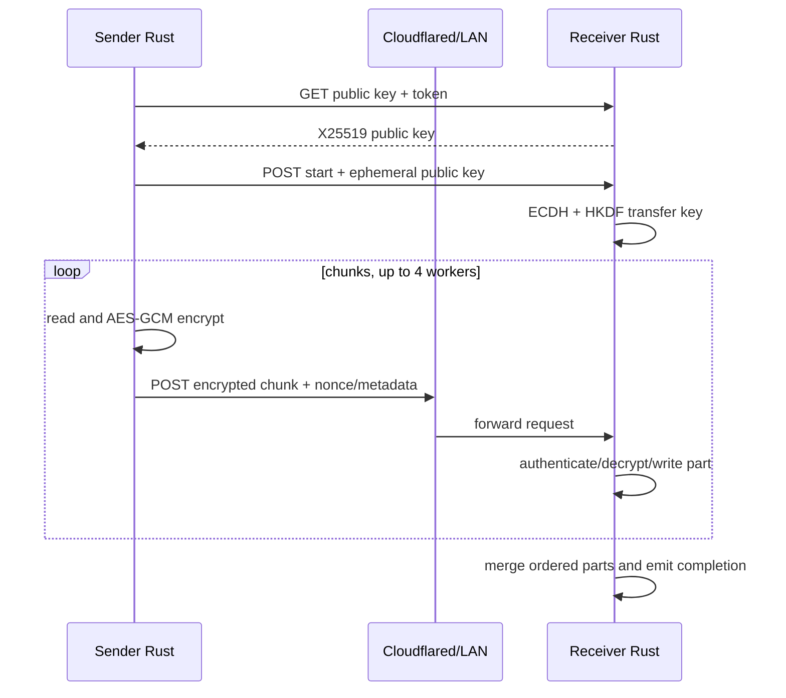

# File Transfer

## Sender path

1. Central API `/transfers` returns `TransferMetadata`: transfer ID, receiver ID, endpoint, auth token, optional chunk size, concurrency, and retry limits.
2. `UploadManager` loads file paths from SQLite by transfer ID and scans them with `scanner.rs`.
3. `chunker.rs` creates jobs using a default 16 MiB chunk size (configurable up to 32 MiB).
4. Rust fetches `/transfer/public-key`, derives an ephemeral X25519/HKDF transfer key, and calls `/transfer/start`.
5. `scheduler.rs` dispatches each chunk as its own async task with eight in flight by default. Each task reads one chunk, compresses it with zstd when the receiver advertised support, encrypts it with AES-GCM, and POSTs it to `/transfer/chunk`.
6. Failed chunks retry up to four times with 1/2/4/8-second delays. Progress is emitted through Tauri events.

### Chunk compression and size negotiation

Both are negotiated, never assumed, because the v1 wire and its installed receivers are frozen:

- `GET /transfer/public-key` returns `vilsend-chunk-encoding: zstd` and `vilsend-max-chunk-bytes: <n>`. A receiver that predates these sends neither header.
- **Chunk size.** The sender plans `min(configured size, advertised max, MAX_CHUNK_SIZE)`. With no header it falls back to the legacy 4 MiB, which is what an installed receiver's 10 MiB body limit accepts; a new receiver advertises 32 MiB and the sender uses its 16 MiB default.
- **Compression.** The sender compresses a chunk only when the encoding header was present. A compressed chunk carries `chunk-encoding: zstd`; an uncompressed one carries no header, which is byte-for-byte the old request.
- Compression happens on the plaintext, before encryption. Manifest hashes, resume digests, the sender's `ExpectedTransfer`, and progress all describe plaintext bytes, so none of them change.
- A chunk that does not shrink is sent uncompressed even on a negotiated session, so already-compressed media pays no overhead.
- The receiver bounds decompression by the chunk length the sender described and refuses a chunk that expands past it (a small body must not become an unbounded allocation).

### Sending

`scheduler.rs` dispatches each chunk as its own async task, bounded by a semaphore at the transfer's concurrency (8 by default). A failed chunk stops new dispatches and lets in-flight chunks finish; a paused transfer parks tasks before they read their chunk.

## Receiver path

The receiver creates an in-memory transfer key and download state during `/transfer/start`. Each chunk is authenticated/decrypted, path-checked for absolute paths and `..`, written to `app-data/transfers/incoming/<transfer>/<file>/<index>.part`, and merged into the configured download directory after all indices exist. Merge writes a `.transfer-tmp` file and renames it into place.

## Current limitations

- `0.0.0.0:7878` exposes the receiver on every interface.
- The receiver checks header presence, not token validity, in the visible code.
- A process-wide async mutex serializes chunk directory/write/merge work across transfers.
- Download state and transfer keys are in memory; restart recovery is not implemented.
- No final whole-file checksum is verified; the `checksum.rs` module is not part of the visible upload/merge path.
- Cleanup of completed incoming parts is not visible in the receiver path.
- Files are read into a full chunk buffer before encryption, which is bounded by chunk size but multiplied by worker count.

## Recommended direction

Use a transfer-session record with expiry, authenticated headers, per-transfer locks, bounded disk quotas, atomic metadata, restart recovery, final hash verification, and explicit cleanup. Keep the current chunked AEAD design but bind associated data to transfer ID, file ID, chunk index, and relative path.
