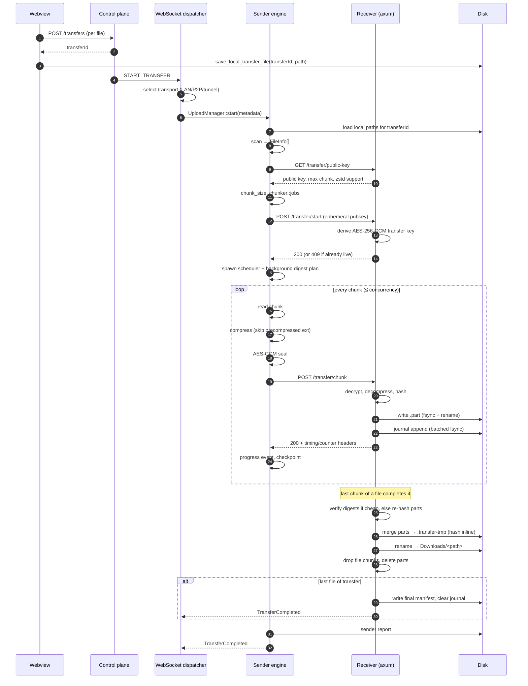

# Vilsend LAN transfer — complete flow

From the moment a sender picks a file until the receiver has the finished file on
disk. This describes the **v1 HTTP path** as it is implemented today, in the
order the code actually runs it.

Files referenced (all under `crates/desktop/src/` unless noted):

| Piece | File |
|---|---|
| UI file picker / new transfer dialog | `src/features/transfers/new-transfer-dialog.tsx` |
| Tauri commands | `commands/transfer_commands.rs`, `commands/local_transfer_commands.rs` |
| Control-plane trigger | `events/dispatcher.rs` |
| Sender engine | `transfer/manager.rs`, `transfer/scanner.rs`, `transfer/chunker.rs`, `transfer/upload.rs`, `transfer/scheduler.rs` |
| Wire (sender side) | `transfer/session.rs`, `transfer/http_client.rs` |
| Compression / crypto | `transfer/compression.rs`, `transfer/crypto.rs`, `transfer/crypto_v2.rs` |
| Receiver routes | `transfer/writer.rs` |
| Durable chunk core | `transfer/chunk_sink.rs` |
| Chunk journal / manifest | `transfer/manifest.rs` |
| Assembly | `transfer/merger.rs` |
| Integrity plan | `transfer/integrity.rs` |
| Events | `events/dispatcher.rs`, `crates/core/src/…` |
| Resume | `transfer/resume.rs`, `transfer/persist.rs` |
| Cleanup | `transfer/cleanup.rs` |
| Reports | `transfer/report.rs`, `transfer/network_report.rs` |

---

## 0. One-sentence version

The webview saves *which local path belongs to a transfer id* in SQLite and asks
the backend to create the transfer; the backend tells the desktop over the
WebSocket to start it; the desktop scans the files, negotiates chunk size and a
transfer key with the receiver, splits the files into 256 KiB–512 KiB chunks, and
streams each chunk (compress → encrypt → HTTP POST). The receiver decrypts,
decompresses, writes the chunk durably as a `.part`, records it in a journal, and
answers 200 only once it is durable. After the last chunk of a file arrives, the
receiver merges the parts, verifies the whole-file digest, and renames the result
into the user's Downloads folder.

---

## 1. Sender picks files (UI)

`new-transfer-dialog.tsx`

1. The user opens the dialog and picks files or a folder through the Tauri dialog
   plugin (`selectPaths`, `open(...)`, lines ~52-63).
2. For a folder, `pathSize` walks it to compute the real byte total (~67-83).
3. On submit (~625-686):
   - `createTransfer` → `POST /transfers` to the control plane, one transfer per
     selected file (the backend assigns `transferId`).
   - The response's `transferId` is paired with the local absolute path and saved
     in the desktop database:
     `saveLocalTransferFile({ transfer_id, file_path, file_name, file_size })`
     → Tauri command `save_local_transfer_file` → SQLite.

**Why this matters:** the desktop does not receive the file paths from the
backend. It receives only a `transferId`; it looks the paths up in the local
SQLite table.

---

## 2. Backend starts the transfer (WebSocket)

When the receiver accepts, the control plane sends a
`START_TRANSFER` WebSocket command. `events/dispatcher.rs` (~111-192) handles it:

1. Parses the optional `transport_manifest`.
2. `transport_manifest::select(...)` chooses a transport (LAN / P2P / relay /
   tunnel) and replaces `endpoint` with the direct endpoint when one is usable.
3. Emits `transport-selected` to the webview (so the UI can show the path).
4. Builds `TransferMetadata { transfer_id, receiver_public_key, endpoint,
   auth_token, chunk_size, concurrency, max_retries, transport, transport_manifest }`.
5. Calls `UploadManager::start(metadata)`.

---

## 3. Sender prepares the transfer

`transfer/manager.rs::start` (`:191` onward). These steps run before any chunk:

1. **Reject invalid input** — empty id/endpoint, or a transfer id already active
   (`:192-206`).
2. **Load the local file list** — `local_files.get_by_transfer_id(transfer_id)`
   from SQLite (`:222-234`). Empty → error.
3. **Scan** — `scanner::scan(&paths)` (`:242`).
   - Recursively walks folders.
   - Produces `FileInfo { id (stable hash of path + size), path, relative_path,
     size, modified_nanos }`.
   - `relative_path` keeps the picked folder's name (`Photos/a.jpg`), not just
     `a.jpg`.
4. **Build the session** — `LegacyV1Session::to(endpoint, token)` (`:258`). All
   wire calls go through the `ProtocolSession` trait.
5. **Ask the receiver what it accepts** — `session.capabilities()` (`:277`) →
   `GET /transfer/public-key`.
   - The receiver returns its long-term public key, the max chunk body it
     accepts, and (if it supports compression) an `X-VilSend-Chunk-Encoding: zstd`
     header (`writer.rs::get_public_key`).
6. **Choose chunk size** (`:287-316`):
   - `chunker::chunk_size_for(total_bytes)`: ≤16 MiB → 256 KiB, larger → 512 KiB.
   - Clamped to the receiver's advertised max, this build's body limit, and
     `MAX_PLANNED_CHUNK_SIZE` (512 KiB).
   - Chunk size is fixed before the digests are computed; it cannot be revised.
7. **Build the chunk jobs** — `chunker::jobs(...)` (`:318`): for each file, one
   `ChunkJob` per chunk (`transfer_id, file_id, index, total, relative_path,
   path, offset, length`).
8. **Handshake / key agreement** (`:354-373`, `session.rs::open`):
   - Fetch the receiver's public key (cached from step 5).
   - Generate an ephemeral X25519 keypair.
   - Derive the shared secret and then the AES-256-GCM transfer key
     (HKDF, `crypto::derive_transfer_key`).
   - `POST /transfer/start` with the transfer id, the ephemeral public key, total
     size, and (if already known) the expected digests.
   - The receiver derives the same key from its private key and stores it in
     memory. If it already had this transfer live, it answers `409 CONFLICT` and
     keeps the key it had; the sender then keeps the key it used before
     (`SessionStart::AlreadyActive`).
   - Record the receiver's compression capability on the session for per-chunk
     encoding.
9. **Build upload state** (`:402-439`):
   - `UploadState` holds the file list, chunk size, concurrency, total bytes,
     counters, pause/cancel flags, the transfer key + auth token, the telemetry,
     and the network report.
   - Persist state and secrets (`store_secrets`, `persist`, `write_network_report`,
     `:456-460`): the transfer key goes to the OS keyring so a restart can resume;
     the checkpoint goes to the sender's app-data directory.
10. **Start the workers** (`spawn_scheduler`, `:472-482`):
    - `state.report.start_timeseries()` starts the 5 s telemetry sampler.
    - `scheduler::run(jobs, concurrency, ...)` runs up to `concurrency` chunk
      tasks (default from `constants`).
    - If digests are enabled (`DESCRIBE_DIGESTS`), a background task
      (`plan_in_background`) hashes every file and builds the
      `ExpectedTransfer` plan; only each file's **last** chunk waits on
      `PlanGate`, so a large transfer is not blocked on hashing. The plan is
      persisted and described to the receiver in a second `POST /transfer/start`
      (answered `409`, which is fine — the receiver just absorbs `expected`).

Nothing has been sent yet at this point except the two handshake requests.

---

## 4. The per-chunk pipeline

For each `ChunkJob`, `scheduler.rs` → `upload::upload_chunk` → the session. This
is the hot loop.

### 4.1 Sender side, per attempt

`scheduler.rs` (~245-330), `upload.rs::upload_chunk` (~171-270),
`session.rs::send_chunk`:

1. **Take a concurrency permit**, mark the chunk in-flight in telemetry.
2. **Open/read the chunk**: `read_at(file, offset, length)` on the blocking pool
   (opened handles are cached, up to 128 per run).
3. **Compress** (`session.rs::send_chunk`):
   - Only if the receiver advertised zstd.
   - **Skipped entirely for already-compressed extensions** (`.zip`, `.7z`, `.gz`,
     `.mp4`, `.jpg`, `.pdf`, … via `compression::is_precompressed`) — the chunk
     goes identity, no CPU spent (`compression.rs:61`, `session.rs:438-449`).
   - Otherwise `zstd` runs on the blocking pool. If it does not shrink the chunk,
     the original bytes are sent (`Ok(None)`).
   - Identity chunks carry no encoding header. Compressed chunks carry
     `X-VilSend-Chunk-Encoding`.
4. **Encrypt** — AES-256-GCM, per attempt (so a retry gets a fresh nonce), in
   place, on the blocking pool. The nonce is sent with the chunk.
5. **POST `/transfer/chunk`** (`http_client.rs::send`, `:442-539`) with headers:
   - `Authorization`, `Transfer-Id`, `File-Id`, `Chunk-Index`, `Total-Chunks`,
     `Relative-Path`, `Chunk-Nonce`, `Encryption: AES-256-GCM`.
   - Body = ciphertext (of the compressed bytes, when compressed).
6. **Handle the response**:
   - `200` → chunk accepted. The response headers carry the receiver's timing
     breakdown (`X-VilSend-LockWait-Ms`, `PartWrite-Ms`, `Journal-Ms`, `Accept-Ms`)
     and live counters (in-flight, journal pending, part files, incoming bytes,
     compactions, journal flushes, compaction ms) for the sender's telemetry.
   - `409` with `X-VilSend-Missing-Chunks` → the receiver dropped specific chunks;
     the sender resends exactly those.
   - `422` → integrity mismatch, do not retry this file blindly.
   - Other non-2xx → retry the whole attempt up to `max_retries` (read, compress,
     encrypt, send again).
7. On success: mark the chunk complete, update progress counters, emit
   `TransferProgress`, checkpoint the sender state.
8. When a **file's last chunk** is acknowledged, `report.file_completed(file_id)`
   is set — the receiver only acknowledges that chunk after it has published the
   file.

### 4.2 Receiver side, per request

`writer.rs::receive` (`:1033` onward):

1. Count the request in-flight (for telemetry), drop the guard on every return.
2. Parse and validate headers: `Transfer-Id`, `File-Id`, `Relative-Path`,
   `Chunk-Index`, `Total-Chunks`; reject `total == 0` and `index >= total`;
   require `Authorization`.
3. Reject an unsafe relative path (`is_contained`): no absolute paths, no `..`,
   no drive/UNC prefixes.
4. If the transfer is marked `refused` (a previous assembly was rejected), answer
   `409` until a new session arrives — this keeps sender and receiver agreeing on
   what was delivered.
5. Look up the transfer key and the `DownloadState`; unknown → `401`/`404`.
6. If the transfer already completed, answer `200` and drop the chunk.
7. Decode and validate the 12-byte nonce.
8. **Decrypt** (`crypto::decrypt_chunk`) on the blocking pool.
9. **Decompress** if `X-VilSend-Chunk-Encoding: zstd`, bounded by the sender's
   described plaintext length (or a hard cap); a body that fails to decompress is
   refused.
10. Hand the plaintext to `chunk_sink::accept` (shared by v1 and v2).

### 4.3 Durable storage (`chunk_sink::accept` → `store_chunk`)

The invariant: **a chunk is acknowledged only after its bytes and its journal
entry are durable.**

`accept` (`chunk_sink.rs:146`):

1. Wait out a pause / refuse a cancelled transfer.
2. Record `chunk_started` in telemetry.
3. Build `{transfers}/incoming/{transfer_id}/{file_id}/{index}.part`.
4. SHA-256 the plaintext on the blocking pool **before** taking any lock.
5. **Reserve the chunk** (`in_flight` map, keyed by transfer/file/index):
   - First attempt owns it.
   - A duplicate waits on a oneshot and then re-checks — the chunk is written and
     fsynced once.
6. **Already-complete check** (outside the transfer lock as of the current code):
   - In-memory manifest has an entry whose length and hash match, and the
     on-disk part still matches (`part_matches`: metadata, mtime fast path,
     otherwise re-hash).
   - If so, answer `AlreadyPresent` and release the reservation.
7. **`store_chunk`** with no transfer lock held:
   - Discard any stale `.part` under that name.
   - `write_part`: write a temporary in the same directory, flush, `sync_all`,
     then rename over `{index}.part`. A crash never leaves a short part under the
     real name.
   - Record the written file's mtime (`written_nanos`) so a later duplicate can be
     recognized without re-hashing.
   - Record the entry in the in-memory `Manifest` under the manifest mutex.
   - `JournalWriter::append`: queue the entry and wait for the batch flush.
     The batcher writes all pending entries and performs **one fsync** for the
     batch (`JOURNAL_BATCH_ENTRIES`); every waiter is woken only when that fsync
     succeeds. An ack therefore implies durability.
   - If the flush fails, the in-memory entry is removed so a retry re-writes
     instead of being answered from memory.
   - **No full-manifest rewrite happens here.** The journal *is* the durable
     record during the transfer; the manifest is written once when the transfer
     ends (see §6), so no fsync of a growing document sits on the chunk path.
8. Release the reservation with `Ok`/`Err`, waking waiters.
9. Update progress counters, emit `TransferProgress`, write the network report.

---

## 5. Assembling and publishing a file

When the last chunk of a file has been stored, `receive` calls
`chunk_sink::finish` (`chunk_sink.rs:502`). It runs under the transfer lock so
only one call can publish:

1. If the transfer already completed, return `Published`.
2. Load the in-memory manifest (the journal was replayed into it at load time).
3. Cheap check: are all `0..total_chunks` recorded? If not → `Incomplete`
   (the normal answer for every chunk except the last).
4. Expensive check, only when needed:
   - If the sender described a whole-file digest **and** every chunk digest, and
     all parts are present by metadata, skip the full re-hash — the merge will
     verify the file anyway.
   - Otherwise `verify_and_prune` re-hashes every part; chunks that no longer
     match are deleted and removed from the manifest, and the pruned manifest is
     persisted (`store_manifest`, counted as compaction under the lock).
5. **Merge** (`merger::merge`):
   - Create the temporary `{destination}.transfer-tmp`.
   - Copy `0.part`, `1.part`, … in index order with a 4 MiB buffer on one
     blocking thread.
   - Hash the assembled bytes inline while copying.
   - `flush` + `sync_all`.
   - If the whole-file SHA-256 does not match the sender's plan: delete the
     temporary, discard the offending chunks from the manifest, persist it, and
     answer the sender `422`/`409` so those chunks are re-sent.
   - Otherwise `rename(temporary, destination)` — atomic publication into the
     user's Downloads folder (`resolve_download_root`: `default_download_location`
     setting or the OS Downloads folder).
6. Remove the file's chunk records from the in-memory manifest and delete the
   `{file_id}` parts directory.
7. Emit `TransferCompleted` when no chunks remain **and** all expected bytes
   arrived (a `DownloadState` covers the whole transfer, so a multi-file transfer
   completes only after the last file).
8. If the transfer is complete:
   - Release the transfer lock.
   - Write the final manifest once (`store_manifest(..., under_lock=false)`),
     clearing the journal. If this fails, the journal survives and is replayed on
     restart — a resend, never a lost acked chunk.
   - Mark status `Completed`, finalize the receiver report (phases, compaction
     totals, journal totals), emit the completion event.
   - Forget the transfer's lock, manifest and journal batcher.

---

## 6. Completion, reports, events

- **Sender**: when the scheduler's queue drains and the last chunk of each file
  was acknowledged, the transfer is marked `Completed`, `finalize` writes the
  sender report (`<app_data>/transfer_state/reports/{transfer_id}.json` +
  markdown, `TransferStore::reports_dir`) and emits
  `TransferCompleted`. The report includes throughput, chunk latency/breakdown,
  compression ratio, receiver-reported timing shares, the time series and
  throughput-decay verdict, receiver journal/compaction counters, and per-file
  rows (`compression_enabled`, `compression_skipped_reason`).
- **Receiver**: `finalize_download` writes its own report under
  `{receiver_root}/reports/{transfer_id}.json` (same schema, role `receiver`).
- Both sides emit `DomainEvent`s; `events/dispatcher.rs` forwards them to the
  webview as `transfer-progress`, `transfer-completed`, `transfer-failed`,
  `transfer-paused`, `transfer-resumed`, `transfer-cancelled` (these exact names
  are frozen by the golden tests).

---

## 7. What is on disk

Sender app-data:

```
<app_data>/transfer_state/{id}.json       checkpoint of in-flight transfers
<app_data>/transfer_state/{id}.plan       digest plan (ExpectedTransfer)
<app_data>/transfer_state/reports/{id}.json(.md)  sender report
OS keyring: transfer_secret_{id}          transfer key, for resume
```

Receiver:

```
<app_data>/transfers/incoming/{transfer_id}/
    manifest.json          compacted manifest (written at handshake and at finish)
    chunks.journal         append-only, fsynced in batches; replayed on load
    {file_id}/{index}.part one durable part per chunk
<app_data>/transfers/reports/{id}.json(.md)
<Downloads>/<relative_path>          the published file
```

`<app_data>` on Windows is `%APPDATA%\in.vilsend.app`.

---

## 8. Resume and restart

- **Sender restart**: `restore_persisted()` reads the checkpoint and keyring
  secret, `resume()` re-opens a session, calls `GET /transfer/status`, and only
  sends chunks the receiver does not hold (`resume::confirmed_chunks_with_plan`).
- **Receiver restart**: in-memory state is gone, the directory is not. On the next
  `POST /transfer/start`, `manifest_handle` → `load_or_default` reads
  `manifest.json`, replays `chunks.journal` over it, and `verified_completion`
  checks each `.part` on disk. The status endpoint reports exactly the chunks
  that are present and still match; the sender re-sends the rest.
- A journal that was never compacted is fine: replay reconstructs the same
  manifest, so no acked chunk is lost. A partial journal line (crash mid-append)
  is skipped — that chunk is simply not counted and is re-sent.
- Pause/cancel: `pause` sets a flag; `cancel` notifies the receiver and removes
  the receiver's transfer directory (`cleanup::remove_transfer`). Abandoned
  incoming directories are removed by a TTL sweep that never touches transfers
  with a live session.

---

## 9. Invariants worth remembering

1. **Ack ⇒ durable.** The receiver answers 200 for a chunk only after the part is
   fsynced and a journal entries covering it is fsynced.
2. **One writer per chunk.** The in-flight reservation makes duplicate requests
   wait for the first write instead of writing twice.
3. **A part alone is not progress.** It counts only with a matching manifest
   entry whose length/hash (or mtime) still agree with the file on disk.
4. **A file is published only after its digest matches** (when the sender
   described one), and is renamed into place atomically; a rejected file never
   appears in Downloads.
5. **The wire is frozen v1**: chunk size ≤512 KiB planned, 4 MiB legacy cap on the
   receiver body limit, identity chunks byte-identical to the pre-compression
   protocol. Compression and all telemetry headers are additive.
6. **The receiver decides the chunk size** it accepts; the sender clamps to it.
7. **Compaction is off the chunk path**: journal-only during the transfer, one
   manifest write at finish. The report's `recv_compaction_under_lock_ms` should
   stay ~0.

---

## 10. Happy-path sequence


